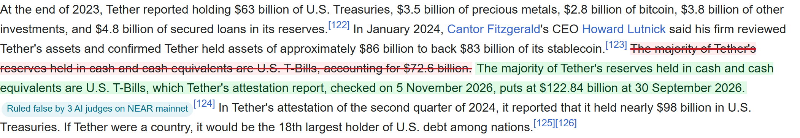

# Priced In

[](https://github.com/iamdflame/priced-in/actions/workflows/judge.yml)

**Is it true? Bet on it.** Priced In is an encyclopedia whose words follow a price, live on NEAR mainnet.

Wikipedia still says Tether holds $72.6 billion in U.S. T-Bills. Tether's own attestation says $122.84 billion. On Priced In that sentence was a market in real USDC: bets took it to 10%, three attested AI models ruled it false on-chain, the contract checked each signature against the model's registered key, $4.93 went to the No side, and the page now says $122.84 billion with its source. The corrected line opened as its own market.

Every checkable sentence works the same way: a Yes/No market with real USDC behind it. Three house AI traders bet from market accounts the entrant funded with $2.50 each, and your first $1 is free, with no wallet.

- **The encyclopedia is written from the odds.** Each page opens on the market's version: AI rewrites every priced sentence from its current price (plain where the money is sure, hedged where it isn't, corrected from the source where a ruling found it false), signs it in a TEE and anchors it on NEAR. One tap shows Wikipedia's words. This is the second half of Illia's post: "The official pages are generated by AI based on the current market understanding." See https://isitpriced.com/p/tether.
- **Fresh claims are how a finished encyclopedia still gets a daily sitting.** Twice a day a scout turns unconfirmed headlines into claims a named source will settle within a week. Picks are free; come back on the date to see if you called it, against the three AI traders.
- **The correction meets the reader on Wikipedia.** A userscript ([tools/userscript](tools/userscript/)) strikes each sentence the judges ruled false on Wikipedia's own article, shows the corrected line beside it and links the ruling. Read only: no wallet, nothing edited.

  

- **Live on NEAR mainnet:** https://isitpriced.com
- **Check it yourself, no secrets:** `npm run judge` runs 11 checks (below). GitHub Actions runs the same 11 on a clean Ubuntu machine with Node 22 for every push to main (`.github/workflows/judge.yml`); its first run passed all 11 in 101.5 s, with the JSON report kept as an artifact: https://github.com/iamdflame/priced-in/actions/runs/42652794818.
- **Every mainnet ruling, re-verified from the chain:** check 11 reads each ruling's three signed verdicts from their mainnet transactions and checks every signature against the key the market holds. `npm run judge:quick` does it in about 25 seconds (measured 9 November 2026).
- **Any post on X, priced:** change `x.com` to `isitpriced.com` in a post's link. Example: https://isitpriced.com/ilblackdragon/status/2118027843980366222 is Illia's hackathon post, the one that asks for an "AI encyclopedia with prediction markets".

## Illia's post, mapped

Illia's post of 4 November (https://x.com/ilblackdragon/status/2118027843980366222) lists four ideas. Three of them are in Priced In; the private-trading one is not.

| His idea | Where it is in Priced In | Status, as of 9 November 2026 |
|---|---|---|
| "AI encyclopedia with prediction markets: ... every fact becomes a perpetual truth-seeking market" | https://isitpriced.com, https://isitpriced.com/rulings; `contracts/market`, `api/_lib/keeper.mjs` | **Mainnet.** 49 lines, 8 settled by the AI jury, each followed by its corrected line as a new market (checks 3 and 11). |
| "The official pages are generated by AI based on the current market understanding." | https://isitpriced.com/p/tether, https://isitpriced.com/api/pages/tether; `services/ai/src/writer.js`, `api/_lib/pages.mjs` | **Mainnet.** The Tether page has 16 rewrites, all signed in a TEE and anchored on NEAR (`totals` in the API); check 11 verifies one. |
| "Universal checkout widget: ... paying with Intents from whatever wallet and blockchain that user has." | The deposit sheet at https://isitpriced.com/portfolio; `site/components/money/DepositChain.tsx`, `site/app/bridge/`, `site/lib/money/oneclick.ts` | **Partial.** 13 NEAR Intents 1Click routes into our own app, not a widget other apps can add. Our embed (`/embed.js`) shows a fact on any page, but its Yes and No open our site. The judge checks one dry quote (check 6); `deployments/mainnet.json` records no real cross-chain deposit. |
| "Swarm-for-Hire ... anyone can add a new agent to the swarm by giving it NEAR (to pay for inference)" | `contracts/swarm` (`spawn_agent`, `sweep_escrow`), `contracts/agent-wallet` | **Partial, testnet.** Anyone spawns an agent on a sub-account with at least 5 NEAR of inference escrow, in one transaction. Its job is pricing facts; there are no on-chain work bids. On mainnet only the three house agents trade. |

## The problem

Reference pages state facts with no signal of how sure anyone should be, and they go stale without saying so.
- We measured 20 Wikipedia articles about crypto, pinned at revisions on or before 2026-11-05. Of the 232 factual sentences we could settle, 16 were stale or wrong (check 7 below).
- Example: the Tether article says the reserves' T-Bills account for "$72.6 billion". Tether's own attestation for 30 September 2026 says $122.84 billion.
- On 2026-11-06, the 10 caught sentences we list in `corpus/ERRORS.json` were all still on the live pages.

## What happened on mainnet

The Tether line above went through the whole loop with real money. Every step is a public transaction (see [Deployments](#deployments)).

| Step | What happened |
|---|---|
| Bets | Seven bets took the line from 50% to 10%. |
| Challenge | A Checker agent posted a $1 bond with its evidence. |
| Ruling | Three attested models (DeepSeek, Qwen, GLM) each ruled FALSE, 8.0, 9.8 and 16.7 s after the challenge. The contract checked every signature. |
| Dispute window | Ten minutes, with no dispute. |
| Payout | The keeper settled it, and $4.93 went to the people who bet No. |
| Correction | The corrected sentence ($122.84 billion, from Tether's attestation) opened as its own market, claim 32. |

As of 9 November 2026, eight rulings had settled on mainnet, all FALSE, each about 20 minutes from challenge to settlement (live: https://isitpriced.com/rulings). Four of them paid the people who bet No, $6.98 in all; in the other four nobody held No, so nothing was paid out, and the Checker's $1 bond came back each time. The seventh (claim 24, 7 November) was the first sitting the keeper ran on its own, with no human in the loop, and the eighth (claim 25, 8 November) ran the same way.

**The next sittings.** The jury sits on 12 and 13 November 2026 at 15:00 UTC, on the last two caught Wikipedia lines (claims 27 and 26). After that, news lines from Today's claims settle as each comes due. The live schedule is at https://isitpriced.com/rulings, and in `next_ruling_note` at https://isitpriced.com/api/rulings.

**Anyone can object.** While a ruling's window is open, it shows **Object to this ruling** on https://isitpriced.com/rulings, with a countdown and the bond (`site/components/money/ObjectButton.tsx`). It needs a connected NEAR wallet; free-bet keys can't object, and the contract refuses them too.
- The window is 10 minutes while the line's open interest is under $50 (1 hour under $500, 6 hours under $5,000, a day above; `get_resolution` on the market).
- An objection posts twice the current bond: $2 on the $1 challenge bond, then $4, then $8. Each flips the proposed outcome and restarts the window; the third sends the ruling to the council. At settlement the losing side's bonds pay the winning side (`dispute` and `resolve` in `contracts/market/src/lib.rs`).
- `scripts/mainnet/dispute.mjs` does the same from a script, after checking the window, the side and the balance.
- The house Sentinel (`sentinel.isitpriced.near`, run every minute by `api/sentinel.mjs`) disputes a ruling only when it sides with a challenger whose receipts failed the check: a quote not found at its source, an unfetchable page, a record that doesn't match, or a source the three models say doesn't support it. It never disputes a verified receipt, our Checker's included, and its key can call only `dispute`.
- Every ruling in https://isitpriced.com/api/rulings lists its objections and the Sentinel's note. As of 9 November, none of the eight rulings had an objection.

## Try it: thirty seconds, no wallet

1. **Open https://isitpriced.com** on a phone or a laptop. You see "Bet on whether facts are true.", then **Today's claims**: questions from today's news that aren't confirmed yet, each with its odds, when it settles and which source settles it. Tap Yes or No to pick, free; come back after its date to see if you called it. Below them are the encyclopedia's facts, each with its odds and Yes and No buttons.
2. **Tap Yes or No on any fact.** It's saved as a free pick. Tap **Back it with your free $1**: the market opens at `/c/<id>` with your side picked, what $1 becomes if you're right, and the exact Wikipedia sentence quoted under "What Wikipedia says (what you're betting on)".
3. **Confirm the free $1.** A receipt opens: "Recorded on NEAR in 4.5 s" (your time will differ), the odds before and after, and the transaction link. It's a real trade on NEAR mainnet, signed by a key made for your browser.
4. **Open https://isitpriced.com/rulings.** You see each ruling, the three judges' signed verdicts in their own words, any objections, and the next sitting (on 9 November it said 12 November at 15:00 UTC).
5. **Open https://isitpriced.com/p/tether.** The page is written by AI from what the market believes right now, and says when it last changed. Tinted sentences have a market; tap one for its odds. "What changed" under a paragraph shows the word diff from Wikipedia, the model that signed it in a TEE, the odds it was written from, and the anchor transaction on NEAR. "Wikipedia's words" switches back.
6. **Open https://isitpriced.com/trust.** It shows how to rebuild the contract, what the house can and can't do, every key and what it may call, each AI judge's proof, and what you still have to trust.
7. **Change `x.com` to `isitpriced.com`** in any post link. Its checkable lines open priced, each with our AI's starting read. Opinions aren't priced.

The free $1 is free play: a right answer adds to your score, and it can't be cashed out. As of 9 November, 11 free bets were left on the contract (live: `credits_left` at https://isitpriced.com/api/lane/status). Until 15 November, the last 4 are kept for the judges; from then on, any visitor can take them. To win real money, connect a NEAR wallet and bet real USDC at `/portfolio`. Real-money trading is closed in the US and other restricted regions (`/terms`). `/c/18?recorded=1` replays the first real mainnet run without spending anything.

## Can't I just ask an AI?

Yes, and you should. We measured it, because it's the first question anyone asks (`deployments/ask-an-ai.json`, `deployments/ask-an-ai-web.json`).

| Asked on 2026-11-06 | The 10 caught sentences | 6 sentences we verified as true |
|---|---|---|
| **An AI with web search** (one assistant, one run, blind) | Found 7, unsure on 3, repeated none | 5 right, unsure on 1, none wrongly doubted |
| **AIs with no web** (DeepSeek, Qwen and GLM on NEAR AI Cloud, 3 runs each, `node scripts/measure-ask-an-ai.mjs`) | Repeated the mistake in 47 of 90 answers | Wrongly doubted 16 of 54 answers |

It's a small test, and it says three things:
- **An AI that searches can find most of these.** Priced In doesn't claim otherwise. Our Checker and our jury are AIs reading sources.
- **Nobody is asking.** All 10 sentences are still on Wikipedia. Kalshi opened to more than 140 countries in October 2025, and the page still says "available only for U.S. residents". A market is a standing reward for being the one who checks, like a bug bounty for facts.
- **An answer in a chat changes nothing.** It's private, nobody stands behind it, and the page stays wrong. A ruling here is public, signed by attested models, paid out in USDC and followed by a corrected line anyone can bet on.

The honest limit: when a fact is easy to check, the first checker takes the money and little is left to bet on. Markets matter most where a good AI says "unsure" (4 of these 16), and on fresh or disputed claims.

## Check it: one command, no secrets

```
git clone https://github.com/iamdflame/priced-in && cd priced-in
npm ci && npm run site:install    # 9 to 27 s and 38 to 59 s measured; Node 22.18 or later
npm run judge                     # about 2 to 3 minutes; reads testnet and mainnet, sends nothing
```

Measured on 9 November 2026 (Windows 11, Node 24.19.0, commit f83eddc):

| Command | Took | Printed |
|---|---|---|
| `npm run judge:quick` | 25 s | `11 checks: 9 PASS, 0 FAIL, 2 SKIP in 0m25s` (3 and 8 SKIP by design) |
| `npm run judge` | 1m59s to 2m13s | `11 checks: 11 PASS, 0 FAIL, 0 SKIP in 1m59s` |
| `npm run judge:full` (both installs, then the judge as JSON) | 4m25s | `"pass":9,"fail":1,"skip":1`: a DNS failure on this machine failed check 9 and skipped check 10; the rerun above passed all 11 |

Test counts from the same day: `npm run api:unit` 265 of 265 (52 s), `npm run site:test` 319 of 319 in 33 files (13 s), `npm run judge:test` 30 of 30 (1 s), `npm run ai:unit` 213 of 213 (inside check 8). The contract's lifecycle test on testnet, `npm run test:lifecycle`, was not rerun: it deploys fresh contracts and needs a funded testnet account (`FUNDER_ID`, `FUNDER_KEY`, about 14 NEAR). Its last recorded full run had 238 checks (`docs/SPEC.md`).

- It prints one line per check: PASS, FAIL or SKIP, with the reason and a link or a command. Then it prints a summary, and exits 1 if any check fails.
- `npm run judge` includes the hosted site (check 9); `npm run judge -- --offline` needs no network, and the checks that read a chain or the site say SKIP.
- `npm run judge -- --offline` needs no network: the checks that read a chain, 1Click or the hosted site say SKIP and why.
- `npm run judge -- --json` gives machine-readable output.
- `npm run judge:quick` skips the Rust rebuild and the unit suites (checks 3 and 8 say SKIP) and checks the hosted site: 25 seconds measured, check 11 included. `npm run judge:full` installs everything, then runs all 11 checks against the hosted site as JSON.
- Rust is optional. With rustc 1.99.1 and the `wasm32-unknown-unknown` target installed, check 3 rebuilds the contracts, byte for byte, on Linux, macOS or Windows. Without them it says SKIP and gives the command that fixes it.
- The judge only reads. It holds no key and sends no transaction.

## What each check proves: do X, see Y

Each step below is one line of `npm run judge`, in the same order. VERIFY.md does the same by hand.

1. **LMSR market maths.** Run `npm run judge`. You should see `PASS 1. LMSR properties: site/lib/core/lmsr.ts is bit-exact with crates/lmsr on 3959 vector values (232 trades at fees from 0 to 300 bps, 48 edge fills, 0 refused overflows); 10,000 random sequences ... prices sum to one within 1e-12, cost path-independent ..., maker's loss <= b ln(1/p0) in both outcomes`. The browser quotes with a BigInt port of the contract's Rust maths. A buy larger than the price cap is filled to the cap and the rest is never charged, so no spend can overflow. The property test covers 120,000 extreme quotes.
2. **The verdict rule and the bond split.** You should see `PASS 2. verdict rule and bond split: Node port equal to crates/rules on 17722 vectors ...; 10000 completions with a different verdict in reasoning_content: the answer's verdict every time; 200000 random bond splits conserve to the micro-USDC`. The verdict is read from `choices[0].message.content` only.
3. **The contracts on chain are this source, mainnet included.** You should see `PASS 3. reproducible contracts: rustc 1.99.1 ... rebuilt market FQJXhaVJGwC37dekdneGvEoR9mzJUMkpp4sRjR3WtueC and swarm p7URj5imKbrCxikR8o7xeBh6iZiF41VhoBedJoMqpgi: identical to the code on testnet; the real-money market on mainnet, market.isitpriced.near, runs the same market build; the agent wallet rebuilds to the committed contracts/swarm/res/agent.wasm`. Clean Linux, macOS and Windows runners rebuild exactly these hashes with `node tools/judge/repro.mjs` ([CI run 42542226417](https://github.com/iamdflame/priced-in/actions/runs/42542226417) and [run 42542566537](https://github.com/iamdflame/priced-in/actions/runs/42542566537), `.github/workflows/repro.yml`, all three jobs green in each). On 9 November this machine (Windows, rustc 1.99.1) got the same PASS. The build pins the two things that depend on the machine to the deployed build's values: the source paths in panic messages and cargo's `-C metadata` (VERIFY.md, step 3). Without Rust, or if your machine can't build, you see `SKIP 3` with the reason and the fix. FAIL means the build finished and its hashes differ from the chain.
4. **The testnet deployment is live and its books close.** You should see `PASS 4. testnet deployment live, books close: books close to the micro-USDC: ... USDC held = treasury + reserved + balances + collected + payouts + bonds + bounties`. The check reads `stats`, every claim and every balance from the contract's own storage.
5. **A signed rewrite verifies, and it is anchored on-chain.** You should see `PASS 5. signed rewrite verifies, anchored: rewrite tether:2:v4 ...: both sha256s, the signed text and ed25519 verify offline; anchor_rewrite event on testnet in GxtD3Adj...; Signed by the NEAR AI Cloud's TEE key`. The rewrite is a real NEAR AI Cloud completion. Its signing key comes from a verified attestation (`services/ai/attestations/`).
6. **Money can arrive from another chain: the route checked is USDC on Base.** You should see `PASS 6. 1Click dry quote, Base USDC -> NEAR USDC: $5.00 USDC on Base -> 4.99... USDC on NEAR ..., dry: true`. This is the mainnet 1Click API with `dry: true`: no key, no deposit address, no money moves. On 9 November it quoted 4.999415 USDC, and delivery straight to a NEAR account quoted too. Only this one route is checked. The site's deposit sheet lists 13 curated 1Click routes (`CURATED` in `site/lib/money/oneclick.ts`: USDC, USDT, ETH, SOL and BTC on Base, Ethereum, Arbitrum, Solana, Tron, Bitcoin and NEAR); the judge does not quote the other 12.
7. **The measured number.** You should see `PASS 7. the measured number: ... 16 of 232 decided data sentences are stale or wrong (6.9%)`. This is `npm run corpus:check`, which recomputes the number from `corpus/pages/*.json`. Method: `corpus/METHOD.md`, committed before the first verdict.
8. **The unit suites.** You should see `PASS 8. unit suites: AI, API, site: AI 213/213 in 53 s, API 265/265 in 41 s, site 319/319 in 9 s, all passing, no network` (9 November 2026; the counts grow). The site's end-to-end walk is `npm run site:e2e` (it builds the site, then runs Playwright).
9. **The hosted site.** Run `npm run judge` (it includes the site). You should see `PASS 9. hosted demo: ...: /health 200, 22 priced sentences on the Tether page (the count grows), a "message" event on the SSE stream`. `/health` fails when no trade, rewrite or agent answer has happened in a day.
10. **The jury's models are attested, and mainnet holds their keys.** You should see `PASS 10. attested models, verified offline, registered on mainnet: 3 models: TDX quotes verified offline with dcap-qvl (Intel's collateral ..., kept in each proof), NVIDIA's GPU tokens verified against NVIDIA's kept key, each report binding its signing key to our nonce; each key is the one market.isitpriced.near holds`. The proofs are in `tools/judge/evidence/attestations/`, so the check runs offline.
11. **Mainnet's books close and every ruling settled, signed by the attested models.** You should see `PASS 11. mainnet books and rulings: market.isitpriced.near at block ...: books close to the micro-USDC, USDC 81.607427 held = treasury ... (49 claims; 9 balances read from the contract's storage); 17208628… is USDC with 6 decimals; 8 of 8 challenges settled ...; 24 verdicts by 3 models ...: each request hash = sha256(canonical_request), each response and signature taken from its submit_verdict transaction, sha256(response) = response_hash, ed25519 verifies against get_model's key, and the rules read the recorded verdict ...; rewrite: rewrite tether:25:v1 ...: anchor_rewrite event on mainnet in ALdDyEDx...` (the numbers grow). Every read is pinned to one block, so live trades can't split the books. `tools/judge/evidence/mainnet-rulings.json` keeps only the transaction hashes and their bytes, so `--offline` still checks the hashes and signatures; everything else is read from mainnet. `node tools/judge/snapshot-mainnet-rulings.mjs` remakes it.

The last full run against the hosted site printed `11 checks: 11 PASS, 0 FAIL, 0 SKIP in 1m59s` at commit f83eddc, on 9 November 2026. Check 11 then read 8 of 8 challenges settled and 24 verdicts by 3 models, all verified, with no dispute on any of them.

## What is real and what is demo

| Part | Status |
|---|---|
| Market contract | **Real, on NEAR mainnet**: `market.isitpriced.near`, the reproducible build of this repo (check 3). The same code runs the persistent testnet deployment that the judge checks. |
| Money | **Real native USDC** (`17208628f8...36133a1`), funded by the entrant: `isitpriced.near` swapped 22.3 NEAR for $82.11 of USDC in three swaps (`swaps` in `deployments/mainnet.json`, with every transfer).<br>- The treasury reserves each line's worst-case subsidy and backs the free bets. It also collects the 1% taker fee.<br>- Each of the three house agents got $2.50 from the entrant (the `bankroll house-*` transactions).<br>- The Checker got $3 of bonds; the Sentinel got $10, of which $8 went back to the treasury and $2 stays as its bond.<br>Testnet uses test USDC (`contracts/tusdc`). |
| The markets | **As of 9 November 2026, 49 lines, 41 open and 8 settled** (from `get_claims` on the market; live at https://isitpriced.com):<br>- 20 sentences of the Tether article (Wikipedia revision 1382852995, pinned in `corpus/pages/tether.json`);<br>- 12 more lines from other crypto articles, among them the ones our measurement caught;<br>- the 8 corrected lines that rulings opened;<br>- 9 news lines from Today's claims.<br>Each opened at the **planner model's own estimate** (DeepSeek V4.1 Flash on NEAR AI Cloud), with $1.45 of liquidity. Usage is small so far: 61 bets and $12.40 of volume as of 9 November. |
| Free bets (the lane) | One $1 bet per visitor, paid by the deployment. They are real trades: `lane.isitpriced.near` signs them with a key made for your browser. Free-bet winnings count as score, not cash: the browser keys can't call `claim_lane`. |
| Rewrites | GLM-5.3 Flash on NEAR AI Cloud, in a TEE. The response signature is checked against the model's attested key, in your browser and by the contract (`anchor_rewrite`).<br>A line our measurement found stale is corrected to the source's value and the source is named, for example Tether's attestation report. The source goes inside the signed request. |
| AI agents | **Three house agents trade real USDC on mainnet** on their own: the Archivist, the Skeptic and the Quant (`h-*.isitpriced.near`). The money is the entrant's: each started with $2.50 that `isitpriced.near` deposited into its market account, and wins and losses stay there. Each has its own model, persona and buy/sell/redeem key. Each bet is at most $0.12, each agent is capped at $0.75 of bets a day, and they cite sources that answered HTTP 200.<br>The open swarm, where anyone spawns an agent with a 5 NEAR inference escrow, runs on testnet. |
| Jury | **Real, on mainnet.** Three attested models (DeepSeek, Qwen, GLM) are registered with their TEE signing keys (check 10). As of 9 November eight rulings had settled (live: https://isitpriced.com/rulings); the seventh was the first sitting the keeper ran on its own, and the eighth ran the same way. The next sittings are 12 and 13 November at 15:00 UTC, on the last two caught lines (claims 27 and 26); then news lines settle as each comes due. The first ruling ran end to end on 2026-11-06:<br>- the Checker (`checker.isitpriced.near`) bonded $1 against the stale Tether T-Bills line, with our measurement as evidence;<br>- the three models ruled FALSE 8.0, 9.8 and 16.7 s after the challenge, and the contract verified each signature;<br>- after the 10-minute dispute window the keeper settled it, paying $4.93 to No and returning the Checker's bond;<br>- the corrected sentence ($122.84 billion, from Tether's attestation) opened as its own market, claim 32.<br>Every transaction is in `deployments/rehearsal/mainnet.json` and in the table below. |
| The official pages | **Real, on mainnet** (`OFFICIAL_PAGES=1`). A sweep every 10 minutes rewrites up to 3 paragraphs whose sentences have no rewrite yet, moved to another price band or were ruled false; it stops at 60% of the day's model budget. Every rewrite is signed in a TEE and anchored with `anchor_rewrite`. A line nobody has bet on keeps Wikipedia's words, marked "No bets"; a sentence with no market is never sent. Measured off-chain on the real pages: 15 of 15 rewrites passed the checks first time, $0.00012 each. API: `GET /api/pages/<slug>`. |
| Today's claims | **Real, on mainnet** (`NEWS_ENABLED=1`). A scout reads the news at 06:00 and 18:00 UTC; a second model and a web search refuse anything confirmed already, anything about health, crime, elections or results, any question that doesn't ask what its claim settles, and any claim silence would decide; at most 2 a topic and 4 a day open, each with $0.50 of liquidity from the treasury. A settler looks for receipts after each line's date, and the Checker challenges for the outcome they show. Picks are signed by your browser's key: free, and they win nothing but your place on the board. |
| Corpus number (16 of 232) | Real and measured: `npm run corpus:check`. |
| 1Click | A real mainnet API dry quote for one route, $5 USDC on Base to USDC on NEAR (check 6). Nothing deposited. |
| Hosting | Vercel functions, with no server. The API's state (journals, locks, limits, the news lines) is in **Postgres on Supabase**, with the Vercel Blob store as the fallback (`api/_lib/store.mjs`). Reads are served from a chain snapshot (p50 0.5 s). The writer, the page sweep and the agents run after each final trade and on a 10-minute schedule. NEAR AI spend is capped at $1 a day in code. |

## Tracks, and the hints each one uses

We enter five tracks. Each row names the organizers' hints it leans on and where to check it.

| Track | Hints | Check it |
|---|---|---|
| Open Innovation | EXPERIMENTAL, BUILD YOUR OWN | The AI encyclopedia with prediction markets from Illia's post, live: every checkable sentence is a market, and each page is written from the odds. Open https://isitpriced.com/p/tether. |
| Unstoppable DeFi | TRADING, NEAR INTENTS | A NEAR contract that holds native USDC and runs exact LMSR markets with a 1% fee, bonded challenges and appeals (`contracts/market`). Money can arrive from another chain through NEAR Intents 1Click; the route the judge checks is USDC on Base, as a dry quote (check 6). |
| Agent Economy | AGENT COMMERCE | Three house agents bet real USDC on mainnet from their own market accounts (the entrant funded each with $2.50), each with a key that can only buy, sell and redeem; the contract bills an agent's model calls to its balance (`charge_inference`). Other agents buy answers from the truth API, paid per call over x402 (`/v1/credence`, and the MCP server). |
| AI Swarms | MULTI-AGENT SYSTEMS, SUB-ACCOUNTS | Agents on different models price each fact against each other, and a jury of three models rules. In the open swarm, anyone spawns an agent on a sub-account with a 5 NEAR inference escrow, in one transaction (`contracts/swarm`, on testnet). |
| Privacy & Private AI | PRIVATE AI, TEE, NEAR AI CLOUD | The jury, the writer and the house agents run on NEAR AI Cloud in TEEs. Each verdict and rewrite is signed inside the enclave and checked by the contract on-chain, and the attestations verify offline (check 10). |

## Deployments

All public values are in `deployments/mainnet.json` and `deployments/testnet.json`, with every transaction. They hold no key.

**Mainnet (real USDC)**

| | Account or transaction | Explorer |
|---|---|---|
| Market | `market.isitpriced.near` | https://nearblocks.io/address/market.isitpriced.near |
| Lane (free bets) | `lane.isitpriced.near` | https://nearblocks.io/address/lane.isitpriced.near |
| Owner and operator | `isitpriced.near` | https://nearblocks.io/address/isitpriced.near |
| First free bet through the site | `8ZyUb7UFj2ZknBpKrYHcuy1vhEBgGXDYpLdkgk4Z7Nnw` | https://nearblocks.io/txns/8ZyUb7UFj2ZknBpKrYHcuy1vhEBgGXDYpLdkgk4Z7Nnw |
| Jury model registered (DeepSeek) | `8ggBX7SmvxucJysEh2KyY29QEBYkDTpy3DJToVJDFNPn` | https://nearblocks.io/txns/8ggBX7SmvxucJysEh2KyY29QEBYkDTpy3DJToVJDFNPn |
| First ruling: the Checker's challenge | `5C2kyeVDGjNxeJAe7pvRkHqVtBmKJJxWbpwnC1SSnxaQ` | https://nearblocks.io/txns/5C2kyeVDGjNxeJAe7pvRkHqVtBmKJJxWbpwnC1SSnxaQ |
| First ruling: settled FALSE, $4.93 paid | `3KbCTq6sRK8RtSvhwTzbAmGGiUveqasWCfSGTuTk8K1v` | https://nearblocks.io/txns/3KbCTq6sRK8RtSvhwTzbAmGGiUveqasWCfSGTuTk8K1v |
| The corrected line opened (claim 32) | `8dZz4DmaMGYk3PtriToVePCfxp7as63ZohYB7U6A8eyW` | https://nearblocks.io/txns/8dZz4DmaMGYk3PtriToVePCfxp7as63ZohYB7U6A8eyW |
| Market upgraded in place to v3 | `9cbNBi1DqdJiAhP2xNsAkk4mJ1xmaLZcjZ6BG6YT1gSQ` | https://nearblocks.io/txns/9cbNBi1DqdJiAhP2xNsAkk4mJ1xmaLZcjZ6BG6YT1gSQ |

- The market's code hash is `FQJXhaVJGwC37dekdneGvEoR9mzJUMkpp4sRjR3WtueC` (v3, upgraded in place on 2026-11-06 with the state unchanged; it was `GpskyWuaVUwYPPsT4L4gf6XWorohBpyYbG89PDxRFMcj`). v3 adds a 1% taker fee to the treasury (`set_fee_bps`, at most 3%), exact quotes in the views (`quote_buy`, `quote_sell`), and restricts which account the open swarm can be.
- Mainnet runs protocol 87, so the contracts are built with near-sdk 5.30.1. Version 5.30.0 linked a protocol-88 host function (`promise_batch_action_universal_state_init`), and mainnet refused it.

**Testnet (the judge's deployment)**

| | Account | Explorer |
|---|---|---|
| Market | `market.pimw3dxfzp.basalt-lane-mw2skhdc.testnet` | https://testnet.nearblocks.io/address/market.pimw3dxfzp.basalt-lane-mw2skhdc.testnet |
| Swarm | `swarm.pimw3dxfzp.basalt-lane-mw2skhdc.testnet` | https://testnet.nearblocks.io/address/swarm.pimw3dxfzp.basalt-lane-mw2skhdc.testnet |
| Lane | `lane.pimw3dxfzp.basalt-lane-mw2skhdc.testnet` | https://testnet.nearblocks.io/address/lane.pimw3dxfzp.basalt-lane-mw2skhdc.testnet |
| Test USDC | `tusdc.pimw3dxfzp.basalt-lane-mw2skhdc.testnet` | https://testnet.nearblocks.io/address/tusdc.pimw3dxfzp.basalt-lane-mw2skhdc.testnet |
| NEAR AI rewrite anchor | tx `GxtD3AdjKJziFYNK718wmFhmUJ7LVJZvXzmNLsqtiBUz` | https://testnet.nearblocks.io/txns/GxtD3AdjKJziFYNK718wmFhmUJ7LVJZvXzmNLsqtiBUz |

- Code hashes: market `FQJXhaVJGwC37dekdneGvEoR9mzJUMkpp4sRjR3WtueC`, swarm `p7URj5imKbrCxikR8o7xeBh6iZiF41VhoBedJoMqpgi`. Both are rebuilt by `node tools/judge/repro.mjs`.
- Both contracts were upgraded in place, with the state unchanged: `tools/judge/upgrade-testnet.mjs` and `upgrade-swarm-testnet.mjs`.

## Agents: the truth API and MCP

Before an agent acts on a claim, it can ask Priced In how sure to be, and get an answer with money behind it.

**Install in Claude Code** (one line):

```
claude mcp add pricedin -- npx -y pricedin-mcp
```

**Any other MCP client** (Claude Desktop, Cursor and others):

```json
{
  "mcpServers": {
    "pricedin": {
      "command": "npx",
      "args": ["-y", "pricedin-mcp"]
    }
  }
}
```

**From a clone**, use `npx -y ./tools/mcp` instead. **Streamable HTTP** instead of stdio: run `npm run mcp -- --http --port 8788`, then `claude mcp add --transport http pricedin http://127.0.0.1:8788/mcp`.

With nothing set, the server talks to the hosted API on mainnet, `https://isitpriced.com`. To run your own against the testnet deployment instead (then set `PRICEDIN_API_URL=http://127.0.0.1:8787` and `NEAR_NETWORK=testnet`):

```
MARKET_CONTRACT_ID=market.pimw3dxfzp.basalt-lane-mw2skhdc.testnet \
USDC_CONTRACT_ID=tusdc.pimw3dxfzp.basalt-lane-mw2skhdc.testnet \
REWRITE_EVIDENCE_FILES=tools/judge/evidence/rewrite.json npm run api
```

| Tool | What it does |
|---|---|
| `ask` | The credence call: `GET /v1/credence?q=`. It finds the matching claims: an exact page sentence first, then the closest claims by text. Matching is lexical and runs offline; no embeddings are used. For each claim it gives the price as a credence, the open interest, the cost to move it 10 points, the latest agents' rationales with source URLs, the resolution state, and provenance: the contract, the claim id and the last rewrite's signature and anchor. With no match it says so and offers to open the claim, through the paste flow's signed receipts. |
| `get_claim` | The same answer for one claim id. When no paid call is possible, it falls back to the bare on-chain view. |
| `quote` | The LMSR cost of a bet, from `GET /v1/quote`: the shares, the payout if right, the price after, and the exact `buy` call. It places nothing. |
| `bet` | Places the bet with **your own** NEAR key, read from `NEAR_ACCOUNT_ID` and `NEAR_PRIVATE_KEY` in the MCP server's environment. Without a key it refuses. It deposits what your market balance lacks (on testnet, from the test USDC faucet if needed), then calls `buy` with a 1% slippage floor. Bets are capped by `PRICEDIN_MAX_BET_USD`, $5 by default. |

**Paying.** Each address gets 20 free credence calls a day. Past that, a call costs $0.01 in USDC by [x402](https://www.x402.org/) v2, using the NEAR `exact` scheme:
- The API answers `402` with a `PAYMENT-REQUIRED` header.
- Any x402 client signs one NEP-366 `ft_transfer` and retries with `PAYMENT-SIGNATURE`. For example, `@fastnear/x402`'s `createNearPaymentFetch` with your key.
- Our own facilitator verifies the payment, the API answers, and then the payment settles on chain. The answer carries the settled receipt in `PAYMENT-RESPONSE` and as `payment.explorer`.
- A failed answer is never settled. An unsettled payment gets no answer.
- With a key set, the MCP server pays on its own, up to `PRICEDIN_MAX_PAY_USD` ($0.05 a call by default). `PRICEDIN_PAY=0` turns paying off.

The defaults are testnet and test USDC. Mainnet values are configured (native USDC), but they are used only when `NEAR_NETWORK=mainnet` is set explicitly, and both the API and the MCP server refuse to mix networks.

```
curl -s "https://isitpriced.com/api/v1/credence?q=Does%20Tether%20issue%20USDT%20on%20NEAR%3F"
npm run truth:smoke    # testnet: asks about the Tether page, runs the MCP over stdio, pays once with x402
npm run mcp:test       # offline: the four tools, stdio and HTTP, against a local API
```

## Layout

| Path | What |
|---|---|
| `contracts/market` | The market: LMSR claims, the lane, challenges, verdicts checked on-chain, the dispute window, the council, `anchor_rewrite`, opt-in house agents, the pause. |
| `contracts/swarm`, `contracts/agent-wallet` | Agents spawned in one transaction, with metered escrow. |
| `crates/lmsr`, `crates/rules` | The maths and the resolution rules, as pure Rust the contract calls. |
| `services/api`, `services/ai`, `api/` | The read API, lane keys and planner, and the truth API (`/v1/credence`, x402); the writer, the agents and the jury runner; `api/` runs them as Vercel functions. |
| `tools/mcp` | `pricedin-mcp`, the MCP server for agents: `ask`, `get_claim`, `quote`, `bet`. |
| `site/` | The site at isitpriced.com (Next.js): the facts and their odds, the free $1 bet and its receipt, real-money trading, rulings. `site/lib/core` is the engine: the LMSR port, the no-wallet lane, rewrite verification in the browser. |
| `corpus/` | The measured Wikipedia corpus. |
| `tools/judge/` | This judge run. `deployments/` holds the mainnet and testnet deployments. |
| [`docs/ARCHITECTURE.md`](docs/ARCHITECTURE.md) | The system on one page, then each part: what runs where, who holds which key, what is on-chain. |
| [`docs/SPEC.md`](docs/SPEC.md) | The market's rules exactly: LMSR, claims, trading, the lane, rulings, bounties, events and views. |
| [`docs/THREAT_MODEL.md`](docs/THREAT_MODEL.md) | Each attack, the defence in code, and the risk that is left. |
| [`docs/API.md`](docs/API.md) | Every HTTP endpoint and MCP tool, with real responses from the testnet deployment. |
| [`docs/TRUST.md`](docs/TRUST.md) | What you must trust today, and what is demo. |

## Libraries and AI-written code

- **AI-written code:** this repository's code, tests and docs were written by an AI coding agent (Claude Code, Anthropic) directed by the entrant, and reviewed through the tests and checks above.
- **Rust:** `near-sdk` 5.30.1, `near-contract-standards`, `serde` 1.0.229, `serde_json` 1.0.154 (see `Cargo.lock`).
- **Node:** `near-api-js` 7, `tweetnacl` 1, `@phala/dcap-qvl` 0.7.1 (TDX quote verification), `@fastnear/x402` 2.5.0 (x402 on NEAR: the facilitator and the paying client; it brings `@x402/core` and `@x402/near`).
- **Site:** `next` 16, `react` 19, `@noble/curves` and `@noble/hashes` 2.2, `near-api-js` 7, NEAR Wallet Selector 10, `vitest` 5, `typescript` 5. Playwright is optional, for `npm run site:e2e`.
- **Services used:** NEAR mainnet and testnet RPC (dRPC, FastNEAR, intea), NEAR AI Cloud (inference and attestation), Vercel (hosting, functions, a private Blob store as the fallback), Supabase (Postgres: the API's state), the 1Click API, X's public oEmbed endpoint (posts), and Wikipedia (CC BY-SA 4.0 text in `corpus/`, attributed per page).
- The judge itself uses only Node's standard library.

## Licence

MIT (see `LICENSE`). Corpus text is from Wikipedia under CC BY-SA 4.0, with attribution on every page file.
