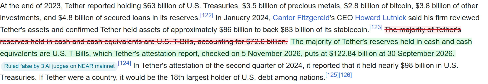

# Priced In on Wikipedia

A userscript that puts each ruling where the sentence lives. On the Wikipedia articles Priced In covers, it strikes every sentence three AI judges ruled false on NEAR mainnet, shows the corrected line next to it, and links the ruling.

- **Install:** a userscript manager (Violentmonkey or Tampermonkey), then open [`priced-in.user.js`](https://raw.githubusercontent.com/iamdflame/priced-in/main/tools/userscript/priced-in.user.js) as raw.
- **Then open:** https://en.wikipedia.org/wiki/Tether_(cryptocurrency) and look for "Ruled false by 3 AI judges on NEAR mainnet".
- **What it reads:** one GET to https://isitpriced.com/api/rulings. No wallet, no account, nothing else sent. Wikipedia itself is not edited; only your browser's view changes.
- **When Wikipedia has fixed the line:** the banner says "Wikipedia has since changed 1" and marks nothing. Measured on 13 November 2026: 8 of the 9 lines ruled false are still on Wikipedia as written; the Ethereum one has changed.
- **Why the manager's request:** Wikipedia's Content Security Policy stops a page from calling other sites, so the script asks through `GM_xmlhttpRequest` (`@connect isitpriced.com`).
